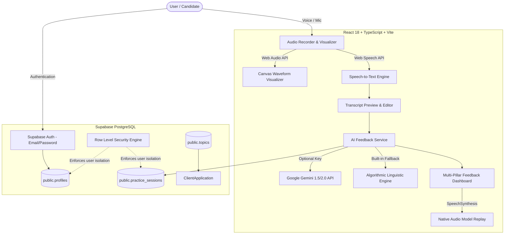

# 🎙️ SpeakDaily — AI English Speaking Practice Platform

[](https://reactjs.org/)
[](https://www.typescriptlang.org/)
[](https://vitejs.dev/)
[](https://tailwindcss.com/)
[](https://supabase.com/)
[](LICENSE)

> A modern, responsive web application designed for daily English speaking practice. SpeakDaily provides curated daily conversational topics, records voice input with real-time waveform visualization, transcribes speech via the Web Speech API, and delivers instant, multi-pillar AI feedback on fluency, grammar, vocabulary, and pronunciation.

---

## 🌟 Executive Summary for Recruiters & Hiring Managers

**SpeakDaily** was architected to solve a critical barrier in language acquisition: *the absence of immediate, low-stress, structured speaking feedback*. 

### Why this project stands out:
1. **Full-Stack Engineering with Supabase**: Implements a secure relational database schema with PostgreSQL, Row Level Security (RLS) policies, and database triggers that automatically sync `auth.users` with user profiles.
2. **Real-Time Browser Audio Pipeline**: Integrates native HTML5 `MediaRecorder`, `AudioContext`, and `AnalyserNode` for low-latency audio capture and 60fps canvas waveform rendering.
3. **Dual Speech Intelligence**: Combines the browser's native `SpeechRecognition` API for live client-side speech-to-text with an AI evaluation engine that scores speaking pace (WPM), filler word density, grammar syntax, and vocabulary richness.
4. **Resilient Hybrid AI Architecture**: Seamlessly calls Google Gemini Generative AI when an API key is present, with an intelligent built-in linguistic NLP analyzer fallback guaranteeing zero downtime and flawless functionality out of the box.
5. **Auditory Learning Loop**: Features Text-to-Speech (TTS) via `SpeechSynthesis` allowing users to listen to a native model pronunciation of their rewritten responses.

---

## 🏗️ System Architecture



---

## ✨ Key Features

- **🎯 Curated Daily Speaking Prompts**: Engaging daily topics spanning culture, technology, career, and travel, complete with contextual talking points and target vocabulary hints.
- **🎙️ Real-time Audio Waveform Visualizer**: Smooth 60fps canvas visualization of vocal cadence and intensity using the Web Audio API.
- **📝 Live Speech-to-Text Transcription**: Immediate transcription as you speak, with manual refinement controls for maximum accessibility.
- **📊 4-Pillar AI Performance Analytics**:
  - **Fluency & Pace**: Real-time Words Per Minute (WPM) calculation and filler-word detection (`um`, `uh`, `like`, `you know`).
  - **Grammar & Syntax**: Precision error detection with side-by-side correction cards and explanations.
  - **Vocabulary Richness**: Lexical diversity rating and idiomatic suggestions.
  - **Estimated Pronunciation**: Composite clarity metric.
- **🔊 "Better Way to Say It" Native Replay**: Polished C1/C2 rewrites of the user's speech with an interactive speaker button powered by speech synthesis.
- **🔥 Habit & Streak Tracking**: Tracks daily practice streaks and speaking minutes to encourage consistent deliberate practice.
- **⚡ 1-Click Recruiter Demo Mode**: Try out the full application instantly without creating an account.

---

## 🚀 Quickstart & Installation

### Prerequisites
- Node.js (v18 or higher recommended)
- npm or pnpm
- A free [Supabase](https://supabase.com) account

### 1. Clone & Install Dependencies
```bash
git clone https://github.com/your-username/speakdaily.git
cd speakdaily
npm install
```

### 2. Configure Supabase Backend
1. Go to your [Supabase Dashboard](https://app.supabase.com) and create a new project.
2. Navigate to the **SQL Editor** tab.
3. Open [`db/schema.sql`](./db/schema.sql) in this repository, copy its contents, paste them into the SQL Editor, and click **Run**.
4. Navigate to **Project Settings** -> **API** and copy:
   - **Project URL**
   - **anon / public key**

### 3. Set Environment Variables
Copy `.env.example` to `.env`:
```bash
cp .env.example .env
```
Update `.env` with your Supabase credentials:
```env
VITE_SUPABASE_URL=https://your-project-id.supabase.co
VITE_SUPABASE_ANON_KEY=your-anon-publishable-key
# Optional: add your Gemini API key for deep generative feedback
VITE_GEMINI_API_KEY=
```

### 4. Run Development Server
```bash
npm run dev
```
Open your browser at `http://localhost:3000`.

---

## 🗄️ Database Schema Overview

The database is built on PostgreSQL with Row Level Security (RLS) enabled on all tables:

| Table | Purpose | Security Policy |
| :--- | :--- | :--- |
| `public.profiles` | Stores user profile, streak count, and total speaking minutes | Select (public), Update (`auth.uid() = id`) |
| `public.topics` | Curated prompts, talking points, and target vocabulary | Select (public read for all users) |
| `public.practice_sessions` | Transcripts, metrics, audio URLs, and AI feedback payloads | Select/Insert/Delete restricted to session owner (`auth.uid() = user_id`) |

### Database Trigger
An automated PostgreSQL trigger `on_auth_user_created` creates a corresponding row in `public.profiles` whenever a new user signs up via Supabase Auth.

---

## 🧪 Testing & Verification

```bash
# Type check TypeScript code
npm run build

# Run Vite preview build
npm run preview
```

---

## 🚢 Deployment

### Deploy to Vercel
1. Push your repository to GitHub.
2. Import the repository in [Vercel](https://vercel.com).
3. Add `VITE_SUPABASE_URL` and `VITE_SUPABASE_ANON_KEY` to the Environment Variables.
4. Click **Deploy**.

---

## 📄 License

This project is licensed under the [MIT License](LICENSE).
